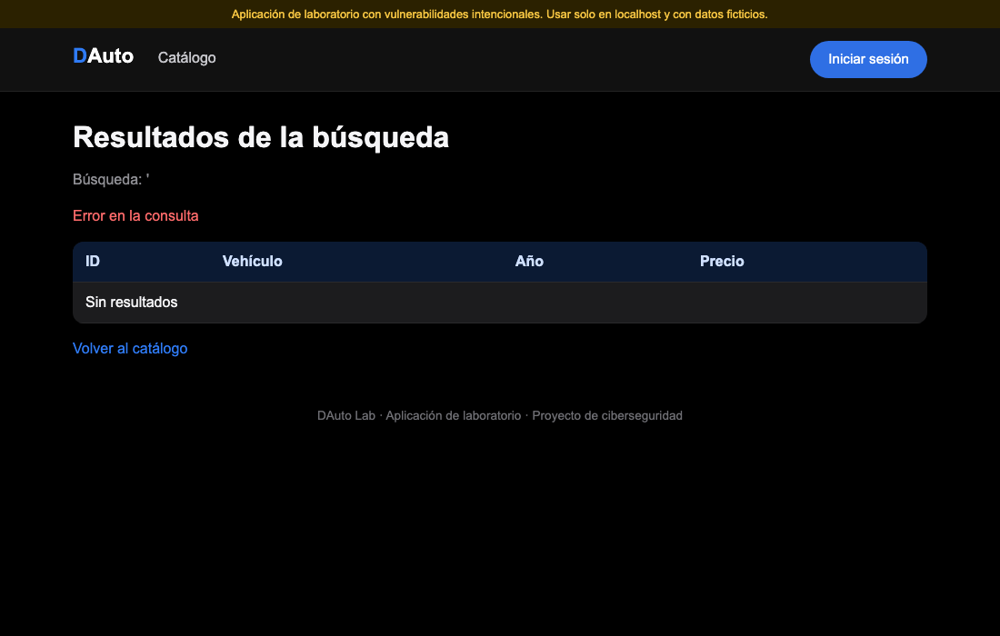
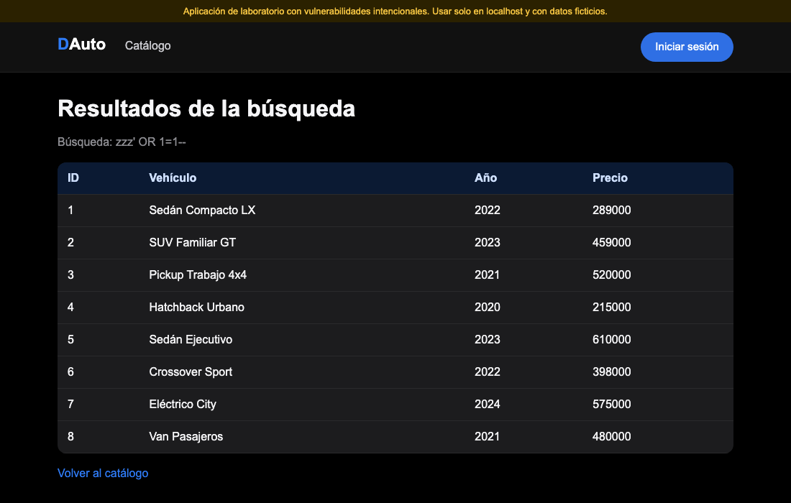
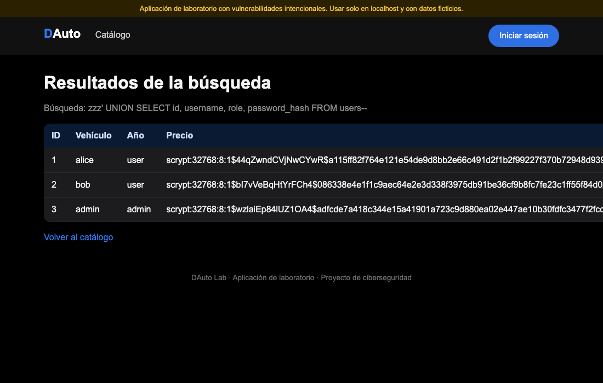
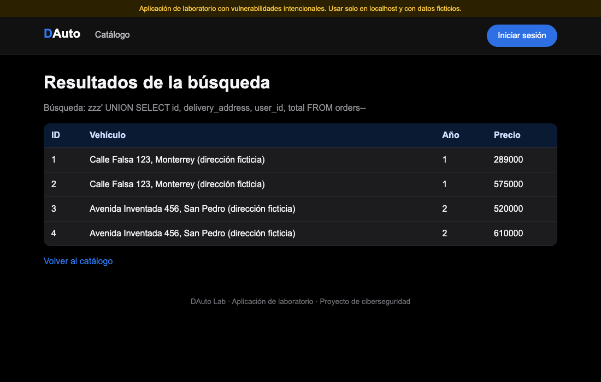
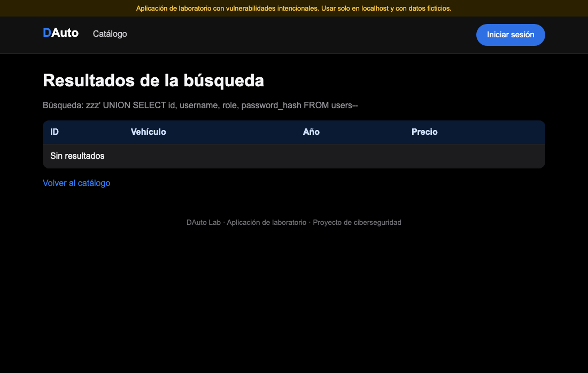
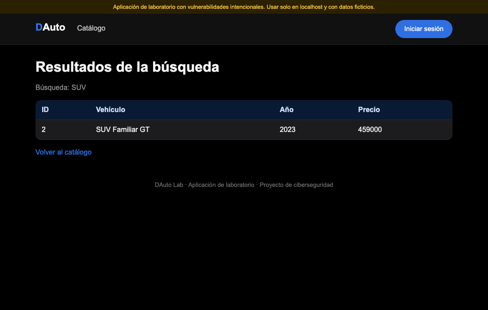

# Parte A: SQL Injection en la búsqueda de vehículos

**Responsable:** Dani · **Rama:** `fix-sqli` · **Archivo corregido:** `app.py`, función `search()`

## 1. Identificación

| Campo | Detalle |
|---|---|
| Vulnerabilidad | SQL Injection (inyección SQL) |
| Clasificación | OWASP Top 10 2021: **A03 Injection** · CWE-89 |
| Ubicación | Ruta `GET /search?q=...`, función `search()` en `app.py` |
| Requiere sesión | No: cualquier visitante anónimo puede explotarla |
| Severidad | **Crítica**: lectura de toda la base de datos sin autenticación |

La búsqueda arma la consulta SQL **pegando el texto que escribe el usuario** dentro de la cadena:

```python
# app.py (versión vulnerable)
q = request.args.get("q", "")
sql = "SELECT id, name, year, price FROM vehicles WHERE name LIKE '%" + q + "%'"
rows = get_db().execute(sql).fetchall()
```

Si el usuario escribe una comilla `'`, cierra la cadena de texto de SQL, y todo lo que escriba después se ejecuta como código SQL.

## 2. Explotación (antes de la corrección)

Todas las pruebas se hicieron en `http://127.0.0.1:5000`, con los datos ficticios del laboratorio.

| # | Payload en `q` | Resultado | Qué demuestra |
|---|---|---|---|
| 1 | `SUV` | 1 vehículo | Uso normal (línea base) |
| 2 | `'` | "Error en la consulta" | La comilla rompe la sintaxis SQL: la entrada llega al motor |
| 3 | `zzz' OR 1=1--` | Los 8 vehículos | Se altera la lógica del `WHERE` |
| 4 | `zzz' UNION SELECT id, username, role, password_hash FROM users--` | 3 usuarios con su rol y hash de contraseña | Robo de credenciales |
| 5 | `zzz' UNION SELECT id, delivery_address, user_id, total FROM orders--` | 4 pedidos con dirección y monto | Fuga de datos personales de clientes |
| 6 | `zzz' UNION SELECT 1, name, 2, type FROM sqlite_master WHERE type='table'--` | Las 5 tablas de la BD | Reconocimiento del esquema |


*Figura 1. Búsqueda normal "SUV": la aplicación devuelve un solo vehículo.*


*Figura 2. Con una sola comilla la consulta falla: indicio de que la entrada se concatena en el SQL.*


*Figura 3. Payload `zzz' OR 1=1--`: aunque "zzz" no existe, se listan los 8 vehículos.*


*Figura 4. Payload `UNION` sobre la tabla `users`: se muestran usuarios, roles y hashes de contraseña en la tabla de resultados.*


*Figura 5. Payload `UNION` sobre `orders`: se exponen direcciones de entrega y montos de todos los clientes.*

**Impacto:** un atacante sin cuenta obtiene los hashes de contraseña (incluido el del administrador) para atacarlos sin conexión, y los datos personales de todos los pedidos. Esto viola la confidencialidad y, en un caso real, sería un incidente con datos personales.

### Registro de eventos (antes)

El log de la aplicación (`app.log`) registra cada búsqueda. Los payloads se ven claramente, lo que sirve para detectar el ataque:

```
2026-11-27 18:37:01,947 INFO SEARCH q='SUV' ip=127.0.0.1
2026-11-27 18:37:01,979 INFO SEARCH q="'" ip=127.0.0.1
2026-11-27 18:37:01,979 ERROR SEARCH_ERROR q="'" error=unrecognized token: "'"
2026-11-27 18:37:02,003 INFO SEARCH q="zzz' OR 1=1--" ip=127.0.0.1
2026-11-27 18:37:02,026 INFO SEARCH q="zzz' UNION SELECT id, username, role, password_hash FROM users--" ip=127.0.0.1
2026-11-27 18:37:02,045 INFO SEARCH q="zzz' UNION SELECT id, delivery_address, user_id, total FROM orders--" ip=127.0.0.1
2026-11-27 18:37:02,066 INFO SEARCH q="zzz' UNION SELECT 1, name, 2, type FROM sqlite_master WHERE type='table'--" ip=127.0.0.1
```

Indicadores para detectarlo: `SEARCH_ERROR` con errores de sintaxis SQL, y palabras como `UNION`, `SELECT`, `OR 1=1` o `--` dentro de `q`.

## 3. Corrección

Se usa una **consulta parametrizada**: el SQL lleva un marcador `?` y el texto del usuario se manda aparte como dato. El motor de SQLite nunca lo interpreta como código, aunque traiga comillas o palabras SQL.

```python
# app.py (versión corregida)
q = request.args.get("q", "")[:100]
patron = "%" + q.replace("\\", "\\\\").replace("%", "\\%").replace("_", "\\_") + "%"
sql = "SELECT id, name, year, price FROM vehicles WHERE name LIKE ? ESCAPE '\\'"
rows = get_db().execute(sql, (patron,)).fetchall()
```

| Medida | Para qué sirve |
|---|---|
| Marcador `?` con el valor aparte | **Corrección principal.** Separa código y datos: elimina la inyección |
| Escapar `%` y `_` con `ESCAPE '\'` | Que los comodines de `LIKE` se busquen como texto literal y no se pueda listar todo con `%` |
| Límite de 100 caracteres | Defensa en profundidad: reduce payloads largos; ningún nombre real lo necesita |

El cambio solo toca la función `search()`, así que no choca con las correcciones de XSS e IDOR en otras partes de `app.py`.

## 4. Validación (después de la corrección)

| # | Payload | Antes | Después |
|---|---|---|---|
| 1 | `SUV` | 1 vehículo | 1 vehículo ✅ (sigue funcionando) |
| 2 | `'` | Error de SQL | Sin resultados ✅ |
| 3 | `zzz' OR 1=1--` | 8 vehículos | Sin resultados ✅ |
| 4 | `UNION ... FROM users` | 3 usuarios con hash | Sin resultados ✅ |
| 5 | `UNION ... FROM orders` | 4 pedidos con dirección | Sin resultados ✅ |
| 6 | `UNION ... FROM sqlite_master` | 5 tablas | Sin resultados ✅ |
| 7 | `%` | 8 vehículos | Sin resultados ✅ |
| 8 | *(vacío)* | 8 vehículos | 8 vehículos ✅ (catálogo completo) |


*Figura 6. El mismo payload de la Figura 4 después de la corrección: "Sin resultados", sin fuga de datos.*


*Figura 7. La búsqueda normal "SUV" sigue funcionando igual tras la corrección.*

### Registro de eventos (después)

Los intentos se siguen registrando (útil para monitoreo), pero ya no aparece ningún `SEARCH_ERROR`, porque la entrada ya no rompe el SQL:

```
2026-11-27 18:37:26,189 INFO SEARCH q='SUV' ip=127.0.0.1
2026-11-27 18:37:26,216 INFO SEARCH q="'" ip=127.0.0.1
2026-11-27 18:37:26,236 INFO SEARCH q="zzz' OR 1=1--" ip=127.0.0.1
2026-11-27 18:37:26,255 INFO SEARCH q="zzz' UNION SELECT id, username, role, password_hash FROM users--" ip=127.0.0.1
2026-11-27 18:37:26,276 INFO SEARCH q="zzz' UNION SELECT id, delivery_address, user_id, total FROM orders--" ip=127.0.0.1
2026-11-27 18:37:26,296 INFO SEARCH q="zzz' UNION SELECT 1, name, 2, type FROM sqlite_master WHERE type='table'--" ip=127.0.0.1
```

### Prueba automática

`test_sqli.py` repite los ataques con el cliente de pruebas de Flask. Se ejecuta desde la raíz del repositorio:

```
python parte-a/sqli/test_sqli.py
```

Resultado con la corrección:

```
test_ataques_no_devuelven_datos ... ok
test_busqueda_normal_sigue_funcionando ... ok
test_busqueda_vacia_muestra_todo_el_catalogo ... ok
test_comodines_like_se_tratan_como_texto ... ok
Ran 4 tests in 0.066s
OK
```

Contra la versión original, la misma prueba falla en 6 comprobaciones (los 5 ataques y los comodines). Así se confirma que la prueba sí detecta la vulnerabilidad.

## 5. Recomendaciones

- Usar siempre consultas parametrizadas (o un ORM como SQLAlchemy) en **todas** las consultas, no solo en esta.
- Conectar la app a la base de datos con un usuario de solo lectura donde se pueda.
- Alertar cuando aparezcan `SEARCH_ERROR` o palabras SQL (`UNION`, `SELECT`, `--`) en `q` dentro de `app.log`.
- Agregar `test_sqli.py` a las pruebas que corren antes de cada merge, para que la falla no regrese.

## Archivos de evidencia

| Archivo | Contenido |
|---|---|
| `evidencias/antes.txt` / `despues.txt` | Resultado de cada payload antes y después |
| `evidencias/antes.log` / `despues.log` | Líneas de `app.log` de cada corrida |
| `evidencias/resultado-pruebas.txt` | Salida de `test_sqli.py` |
| `evidencias/fig*.png` | Capturas de pantalla (Figuras 1 a 7) |
